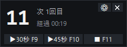
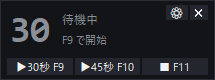
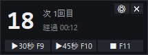
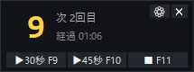
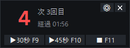
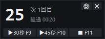
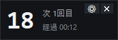
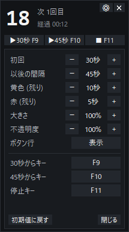
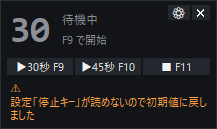

# BPSR ギミックタイマー

ブループロトコル：スターレゾナンスのボス戦で、「**開始 30 秒後に 1 回目が湧き、以後 45 秒ごとに湧く**」
ギミックに合わせるカウントダウンタイマーです。ゲーム画面の上に小さく重ねて表示します。

ゲームのファイル・メモリ・通信には一切触れず、ゲームへキー操作を送ることもない、ただのタイマーです。

## ダウンロード

**[BPSRGimmickTimer.exe（最新版）](https://github.com/0xhr-dev/bpsr-gimmick-timer/releases/latest/download/BPSRGimmickTimer.exe)**
（[リリース一覧](https://github.com/0xhr-dev/bpsr-gimmick-timer/releases)）

- Windows 10 / 11。インストール不要、ダブルクリックで起動します。
- 起動すると「このアプリがデバイスに変更を加えることを許可しますか？」(UAC) と出るので「はい」を選びます。
  ゲームが管理者権限で動いているため、タイマーも管理者権限でないと、ゲームを操作している間のキーを
  受け取れません（Windows の仕様）。
- 初回は「Windows によって PC が保護されました」と出ることがあります。署名していない exe のためで、
  「詳細情報」→「実行」で起動できます。

## 使い方

1. ゲームを **ボーダーレスウィンドウ** にします。排他フルスクリーンでは、どんなウィンドウも
   ゲームの上に表示できません。
2. `BPSRGimmickTimer.exe` を起動し、UAC の確認で「はい」を選びます。
3. 戦闘開始と同時に **F9** を押します。30 秒後に 1 回目、以後 45 秒ごとに自動で数え直します。
4. 終わったら **F11** で止めます。

| 操作 | 内容 |
|---|---|
| **F9** | **30 秒から**開始（初回 30 秒 → 以後 45 秒ごと）。動いている最中に押すと最初からやり直し |
| **F10** | **45 秒から**開始（最初から 45 秒ごと）。湧いた直後に押せば、そこから数え直せます |
| **F11** | 停止 |
| ドラッグ | 窓を移動（位置は次回の起動でも保たれます） |
| ⚙ | 設定欄を開く / 閉じる |
| ✕ | 終了 |

- 大きな数字は次に湧くまでの残り秒です。**残り 10 秒で黄色、5 秒で赤**になります。
- 「次 N回目」は、これから湧くのが何回目かを示します。
- ホットキーはゲームを操作したままで効きます。キーはゲームにもそのまま届くので、ゲームの操作に
  割り当てていないキーを使ってください。
- ボタンをクリックしても、ゲームからフォーカスは外れません。

| 待機中 | 通常 | 残り 10 秒以下 | 残り 5 秒以下 |
|:---:|:---:|:---:|:---:|
|  |  |  |  |

| 45 秒から開始 | ボタン行を隠した形 |
|:---:|:---:|
|  |  |

## 設定

⚙ を押すと、タイマーの下に設定欄が開きます。変えた値はすぐに反映され、
exe と同じフォルダの `config.json` に保存されて次回も引き継がれます。

| 項目 | 内容 |
|---|---|
| 初回 / 以後の間隔 | 湧くまでの秒数（初期値 30 / 45） |
| 黄色 / 赤 | 残り何秒で色を変えるか（初期値 10 / 5） |
| 大きさ | 60〜200% |
| 不透明度 | 30〜100% |
| ボタン行 | 隠すとさらに小さくなります（ホットキーだけで使う場合） |
| 各キー | ボタンを押してから、割り当てたいキーを押します。Ctrl / Alt / Shift との組み合わせも使えます。Esc で取り消し |
| 初期値に戻す | 窓の位置以外を初期値に戻します |

数値は −/+ を押し続けると連続で変わります。設定欄もフォーカスを取らないので、
ゲームを操作したまま変えられます。

 

設定ファイルが読めないときや、管理者権限で動いていないときは、窓の下に ⚠ で理由を表示します。

## 困ったとき

| 症状 | 対処 |
|---|---|
| ゲームの上に出てこない | ゲームがボーダーレスウィンドウになっているか確認してください |
| キーが効かない | 起動時の UAC で「はい」を選んだか確認してください。管理者権限で動いていないと、窓の下に ⚠ が出ます。ノート PC で F キーが音量などに割り当たっている場合は、Fn キーと一緒に押すか、設定欄で別のキーにします |
| 起動しない | exe の隣にある `error.log` に原因が書かれています |

## 仕組み

- **最前面に表示する**: `-topmost` に加え、2 秒ごとに `SetWindowPos(HWND_TOPMOST, SWP_NOACTIVATE)` で
  最前面へ戻します。ゲーム側が前面に出直しても隠れません。
- **フォーカスを奪わない**: 窓に `WS_EX_NOACTIVATE` を付けています。クリックしても窓がアクティブに
  ならないので、キー操作はゲームに届いたままです。
- **キーの検出**: 窓がキー入力を受け取らない（フォーカスを取らない）ため、専用スレッドで 15ms ごとに
  `GetAsyncKeyState` でキーの状態を読み、押された瞬間を検出します。設定欄でのキーの割り当ても同じ方法です。
- **管理者権限で起動する理由**: ゲームが管理者権限で動いているため、一般権限のプロセスからは
  ゲームを操作している間のキーの状態が読めません（Windows の UIPI）。exe には管理者権限を要求する
  マニフェストを入れてあります。

## 開発

Windows / Python 3.11。タイマー本体は**標準ライブラリだけ**で動きます。

| コマンド（このフォルダで実行） | 内容 |
|---|---|
| `py -3.11 run.py` | ソースから起動（管理者権限で起動し直す。`--no-admin` を付けると一般権限のまま） |
| `py -3.11 -m unittest discover -s tests` | テスト |
| `build.bat` | exe を作る（初回は `.venv` を作って PyInstaller と Pillow を入れる） |
| `.venv\Scripts\python tools\make_screenshots.py` | README の画像を撮り直す |
| `.venv\Scripts\python tools\make_icon.py` | アイコンを作り直す |

| ファイル | 役割 |
|---|---|
| `run.py` | 起動スクリプト（exe もこれを固めたもの） |
| `src/overlay.py` | タイマーの窓。最前面・フォーカスを取らない・ドラッグで移動 |
| `src/settings_panel.py` | 設定欄（−/+ とキーの割り当て） |
| `src/schedule.py` | 湧き時刻の計算（Tk に依存しない純粋な関数） |
| `src/hotkey.py` | キーの検出（ホットキー・設定欄での割り当て）と管理者権限の確認 |
| `src/config.py` | 設定の保存と読み込み。読めない値は初期値に戻す |
| `src/theme.py` | 配色とフォント（「大きさ」はフォントの大きさを変えるだけで効く） |
| `tools/` | アイコンと README 用画像の生成（Pillow） |

## ライセンス

[MIT](LICENSE)
